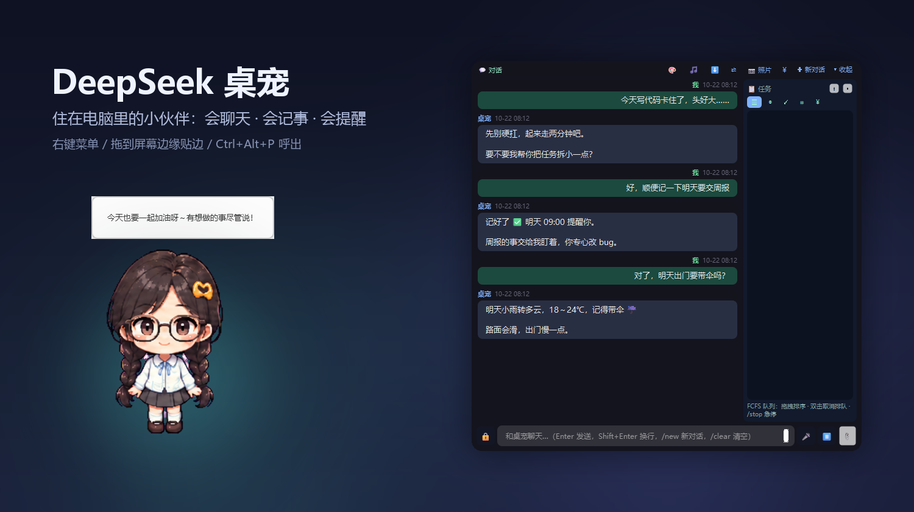
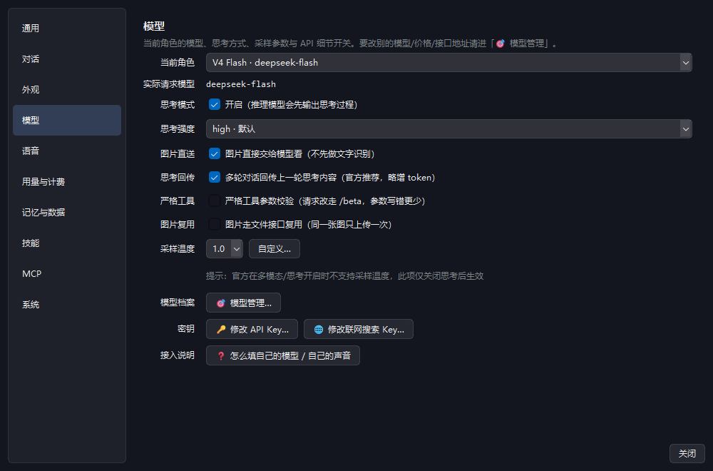
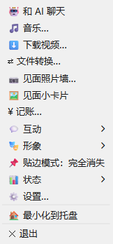
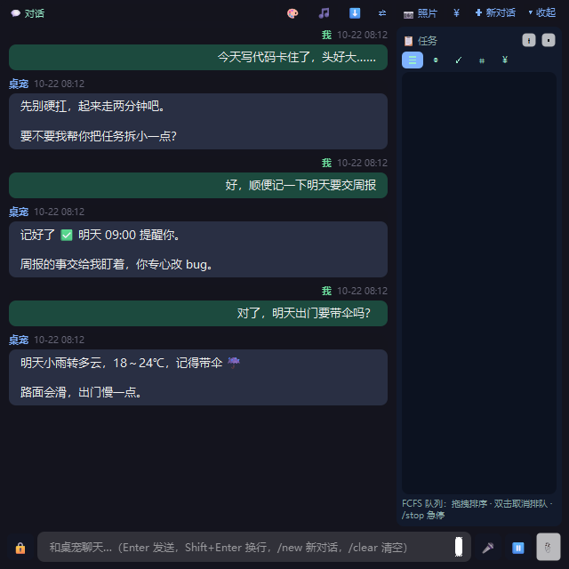
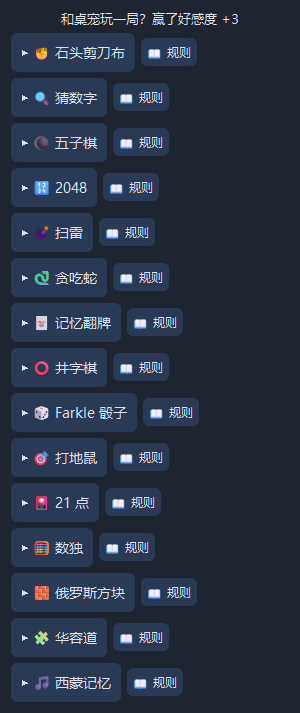

# DeepSeek 桌宠 🐋

一只住在 Windows 桌面上的 AI 小伙伴：会聊天、会记事、会提醒你休息，也能帮你查天气、找文件、玩小游戏。



> 截图里的界面都是本程序真实渲染的，生成脚本见 [`tools/verify_readme.py`](tools/verify_readme.py)。
> 第三方开源项目，与 DeepSeek（深度求索）公司无关联，仅调用其公开 API；角色形象由 AI 生成。

**[English](README.en.md) | 中文**

---

## 🐣 新手三步

| 步骤 | 做什么 | 大概时间 |
|---|---|---|
| 1 | 下载便携包，**完整解压** | 2 分钟 |
| 2 | 双击 `DeepSeekPet.exe` | 10 秒 |
| 3 | 右键桌宠 → 设置 → 模型 → 填 API Key | 1 分钟 |

下面把每一步展开写清楚，照着做就行。不需要显卡，也不需要本地跑模型。

---

## 一、启动程序

### 方式 A：便携版（推荐，零基础选这个）

1. 打开 [Releases 最新版](https://github.com/yty666zsy/deepseek-desktop-pet/releases/latest)。
2. 下载名字类似 `DeepSeekPet_v2.x_portable.zip` 的压缩包。
3. 右键压缩包 → **全部解压**到一个文件夹，例如 `D:\DeepSeekPet`。不要在压缩包里直接双击。
4. 进入解压后的文件夹，双击 `DeepSeekPet.exe`。

**第一次启动会看到什么：**

- 桌宠出现在屏幕上（默认在右上角附近），没有传统的主窗口。
- **右键桌宠**是总入口：聊天、设置、小游戏都在里面。
- 屏幕右下角托盘有它的图标。找不到桌宠时，双击托盘图标，或按 `Ctrl+Alt+P`。

> ⚠️ 不要只把 `DeepSeekPet.exe` 单独拖出来，旁边的 `assets/`（立绘）、`plugins/`（功能）必须一起保留。
> Windows 提示「已保护你的电脑」时，点「更多信息」→「仍要运行」。
> 程序是免安装的，退出后删除整个文件夹即可卸载。

### 方式 B：源码运行（想改代码 / 自己打包）

需要 **Python 3.10 或更高版本**，推荐 3.11 / 3.12。

1. 到 [python.org](https://www.python.org/downloads/) 下载安装包，安装时**勾选 `Add python.exe to PATH`**。
2. 下载源码：GitHub 页面点 `Code` → `Download ZIP`，解压；或者：
   ```powershell
   git clone https://github.com/yty666zsy/deepseek-desktop-pet.git
   ```
3. 打开项目文件夹，在资源管理器地址栏输入 `powershell` 回车，然后执行：
   ```powershell
   python -m pip install -r requirements.txt
   python desktop_pet.py
   ```
4. 以后启动：
   - **Windows**：双击项目里的 `启动桌宠.bat`。
   - **Linux 桌面**：终端执行 `./启动桌宠.sh` 或 `python3 desktop_pet.py`（若在 Wayland 下建议使用 `QT_QPA_PLATFORM=xcb` 以保证悬浮置顶透明效果最佳）。

**源码启动常见卡点：**

| 报错 | 原因 | 处理 |
|---|---|---|
| `'python' 不是内部或外部命令` | 安装时没勾 PATH | 重装并勾选，或把命令换成 `py -3` |
| `ModuleNotFoundError: No module named 'PySide6'` | 依赖没装成功 | 确认在项目文件夹里执行 `python -m pip install -r requirements.txt` |
| 双击 bat 闪一下就没了 | 启动报错被窗口吞掉 | 用 PowerShell 运行 `python desktop_pet.py`，看完整报错 |

> 不想看黑色命令行窗口：把 `python` 换成 `pythonw`。

---

## 二、配置 API Key

桌宠不内置 Key，也不代充，需要你自己的 DeepSeek API Key。

1. 打开 [platform.deepseek.com](https://platform.deepseek.com)，注册 / 登录。
2. 左侧「API Keys」→ 创建 Key，复制形如 `sk-...` 的一串。
3. 回到桌宠：**右键 → ⚙️ 设置… → 左侧「模型」→ 🔑 修改 API Key…**
4. 粘贴 Key，点确定。**立即生效，不用重启。**



5. **验证**：右键 → 「和 AI 聊天」→ 发一句「你好」。能收到回复就成功了。

没填 Key 也能启动，只是 AI 不会回复（聊天里会提示还没配置）。

**手动改配置（可选）**：项目根目录的 `config.json`，没有就新建：

```json
{
  "deepseek_api_key": "sk-你的Key"
}
```

> 🔐 Key 等同于密码，不要发群里、不要截图外传。程序只把它保存在本机 `config.json`，除了请求 API 不会上传到别处。
> 费用按 token 计，以官网价格为准；程序内「设置 → 用量与计费」可以看每次花了多少。

---

## 三、认识界面

### 右键菜单

右键桌宠，最常用的功能都在这里：

<p align="center"></p>

| 菜单项 | 用途 |
|---|---|
| 💬 和 AI 聊天 | 打开对话面板 |
| 🎵 音乐… | 搜歌、播放，歌词显示在头顶（需 MusicFree 插件） |
| ⬇ 下载视频… | B 站 / YouTube / 抖音等（需本机有 `yt-dlp` 和 `ffmpeg`） |
| ⇄ 文件转换… | 图片 / 文档 / 音视频互转，也可把文件拖到桌宠身上 |
| 📷 见面照片墙… | 按日期整理照片，写标题、地点和心情 |
| ¥ 记账… | 说一句「午饭 32」就记一笔，可看月度报表 |
| 🎭 互动 ▸ | 说话、喂食、小游戏、睡觉、朗读开关 |
| 🎭 形象 ▸ | 换角色、静态 / Live2D、性格、大小与透明度 |
| 📌 贴边模式 | 扒边（露一点）或完全消失 |
| 📊 状态 ▸ | 关系、回忆相册、API 用量 |
| ⚙️ 设置… | 所有配置都在这个窗口里 |
| 最小化到托盘 / 退出 | 后台常驻或彻底关闭 |

**快捷键**：`Ctrl+Alt+P` 呼出聊天 · `Ctrl+Alt+D` 截屏发给桌宠 · 鼠标停在人物上 `Ctrl+滚轮` 调大小。

### 聊天面板

<p align="center"></p>

- 左边是聊天记录，右边栏可放任务 / 待办 / 花费，标题栏能收起。
- 输入框按 `Enter` 发送，`Shift+Enter` 换行。
- 标题栏 `＋ 新对话` 会清空上下文（旧对话自动存档到 `chat_archive/`）。
- 面板边缘可以拖动改大小，不会挤坏立绘。

---

## 四、常用设置

所有设置都在「右键 → 设置…」里，改完立即生效。

| 想改什么 | 在哪一页 |
|---|---|
| 性格、回复长短 | 对话 |
| 主动关心、默认城市、贴边方式 | 通用 |
| 立绘大小、透明度、静态 / Live2D | 外观 |
| 朗读声音、语速 | 语音（默认关闭） |
| API Key、模型、思考模式 | 模型 |
| 开机自启、快捷键、平台自检 | 系统 |
| 清空记忆、导出对话 | 记忆与数据 |

新手最常调的两个：

- **嫌回复太长**：设置 → 对话 → 回复风格选「简短」。
- **不想它主动说话**：设置 → 通用 → 取消「主动关心」。

---

## 五、它还能做什么

- **记得你**：长期事实 + 对话摘要 + 共同经历，按角色隔离；`/回忆 关键词` 本地搜索，不花 API。
- **主动关心**：隔一段时间冒个泡；你说「明天考试」它会到点来问；深夜和忙碌时自动安静。
- **帮你做事**：查天气、设提醒、打开程序、锁屏、音量、找文件、剪贴板、待办等十多个工具。
- **陪伴内容**：好感度与等级、15 款小游戏、音乐、照片墙、记账、文件转换、视频下载。

<p align="center"></p>

> 音乐、视频下载、文件转换、Live2D 是可选功能，需要额外插件或本机工具；不用也不影响聊天。详见 [`使用说明.txt`](使用说明.txt)。

---

## 六、出问题先看这里

| 现象 | 可能原因 | 怎么处理 |
|---|---|---|
| 双击没反应 | 已经在托盘 / 被安全软件拦了 | 看右下角托盘；用命令行运行看报错；把文件夹加入杀毒白名单 |
| 找不到桌宠和聊天窗 | 被最小化或贴边隐藏了 | 双击托盘图标，或按 `Ctrl+Alt+P` |
| AI 一直不回 | Key、余额、网络或模型名的问题 | ① 重新填 Key；② 官网看余额；③ 能否打开 `api.deepseek.com`；④ 设置 → 模型 → 模型管理 → 🩺 连通性自检 |
| 没有声音 | 朗读默认关闭 | 设置 → 语音 → 打开朗读；语音输入还需在 Windows 隐私设置里允许在线语音识别 |
| 人物太小 / 太透明 | 之前调过外观 | 鼠标停在人物上 `Ctrl+滚轮`，或设置 → 外观 里恢复默认 |
| 下载 / 音乐 / 转换不能用 | 缺外部组件 | 按 `使用说明.txt` 装 `yt-dlp`、`ffmpeg` 或 MusicFree；这些是可选功能 |
| 想彻底卸载 | — | 退出桌宠，删除整个程序文件夹；数据也在一起，删前先备份 `photos/` 和 `memories.json` |

---

## 七、数据与隐私

| 文件 / 目录 | 内容 |
|---|---|
| `config.json` | API Key、性格、城市等本机设置 |
| `models.json` | 模型档案（不含 Key） |
| `memories.json`、`affection.json` | 长期记忆、好感度 |
| `chat_archive/`、`photos/`、`ledger.json` | 对话存档、照片、账本 |
| `logs/` | 审计与排障日志 |

只有你主动发送的对话和图片会送到 DeepSeek API；记忆、账本、照片都只存本地。可选的「前台程序感知」默认关闭，只读程序名，不截屏、不读窗口内容。

---

## 开发者

技术栈：**Python + PySide6 (Qt)**，DeepSeek API 流式 function calling。

```
desktop_pet.py        主程序（窗口 / 聊天 / 工具分发）
settings_ui.py        统一设置窗口
model_registry.py     模型档案
deepseek_client.py    网络层
pet_*.py              语音 / 音乐 / 照片 / 记账 / 下载 / 转换等模块
memory_*.py           记忆检索与存储
tests/                单元测试与回归
tools/                打包与截图自检脚本
docs/                 设计与排障文档
```

```powershell
python -m pytest tests/    # 跑测试（需先 pip install pytest）
powershell -ExecutionPolicy Bypass -File tools\build_portable.ps1 -Version 2.9.1   # 打包
```

更多：[贡献指南](CONTRIBUTING.md) · [Live2D 流程](docs/live2d_pipeline.md) · [更新日志](CHANGELOG.md) · [安全说明](SECURITY.md)

---

## 📄 License

[MIT](LICENSE)

**免责声明**：本项目仅供学习交流。立绘素材由 AI 生成，使用请遵守相应生成工具的条款。
